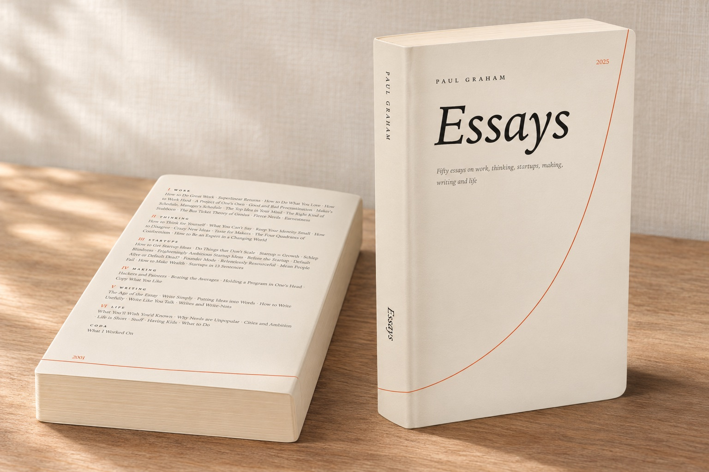
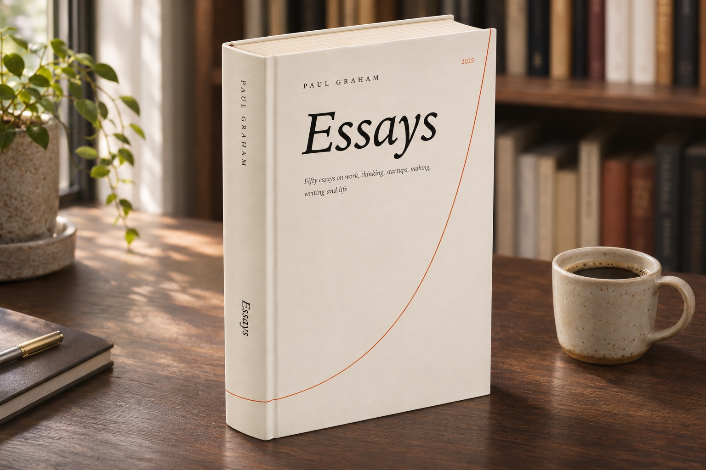

# Essays: a printable Paul Graham reader

Make yourself a real, well-designed book of fifty Paul Graham essays and print a single copy on [Lulu](https://www.lulu.com) for about $14 in paperback or $23 in hardcover.

| Paperback | Hardcover (case wrap) |
|---|---|
|  |  |

<sub>These are AI renderings made from the real cover file, so small details may differ from the printed book.</sub>

> **Unofficial.** This project isn't affiliated with or endorsed by Paul Graham or Y Combinator. The repo contains **no essay text**: the build script downloads the essays from [paulgraham.com](https://paulgraham.com) on your own computer, for your own copy. See [Copyright](#copyright).

## The fastest way: let an AI agent do it

Paste this into an AI agent that can run commands on your computer and control your browser, such as Claude Code with Claude in Chrome. Sign in to [lulu.com](https://www.lulu.com) first.

The agent builds the book, sets up a **private** Lulu project, uploads the files and fills your cart. It stops twice: once for your shipping address, and again before payment.

```text
Help me print a personal copy of the book from https://github.com/giulioco/pg-essays-book
on Lulu. Paperback unless I say hardcover. I'm signed in to lulu.com in my browser.

1. Clone the repo, install Typst (brew install typst) and the Python requirements
   (pip3 install -r requirements.txt), then run: python3 build.py
   Read out/ORDER.md and keep its values at hand.

2. In my browser, open https://www.lulu.com/create/print-books and click
   "Start Making My Print Book".
   - Product type: Print Book.
   - Goal: "Print Your Book" (upload files and buy copies). NOT "Publish Your Book".
   - Project title: Essays. Language: English. Book category: Business & Economics.
   - Click "Design Your Project".

3. Design step:
   - Upload out/interior.pdf under "Interior File Upload". Lulu should read 495-ish pages.
   - Book size: "US Trade (6 x 9 in / 152 x 229 mm)". A "Please select a Book Size" note
     may stay on screen even after selecting it; it doesn't block anything.
   - Specs: Standard Black & White, 60# Cream — Uncoated, Paperback Perfect Bound
     (or Hardcover Case Wrap), Matte.
   - Under "Upload Your Cover", read the required "Dimensions". If they differ from
     out/ORDER.md (always the case for hardcover), run
     python3 build.py --cover WIDTHxHEIGHT   (Lulu's numbers, in inches)
     and use the new out/cover.pdf. Upload out/cover.pdf.
   - If your browser tool can't upload files from the repo folder, copy the two PDFs
     somewhere it can read and upload from there.
   - In "Book Preview", check that cover text sits inside the safety zones and the spine
     title is between the fold lines. Show me a screenshot.

4. Click "Review Book", check the specs, click "Confirm and Publish" (under the
   "Print Your Book" goal this stays private), then "Add to Cart". Quantity 1.

5. Open the cart and click "Checkout". STOP at the shipping address form and let me fill it in.
   When I say so, pick the cheapest tracked shipping, continue to the payment step,
   and STOP. Summarize book, price, shipping, tax and total. I'll pay myself.

Rules: never choose "Publish Your Book", retail sales, distribution or an ISBN. Never
enter my personal or payment details. Don't try to get past security checks or
CAPTCHAs: wait, or ask me. If anything on screen doesn't match these steps, stop and ask.
```

Prefer to do it yourself? Follow the steps below. [PRINTING.md](PRINTING.md) has the click-by-click guide.

## Three steps

**1. Install** Python 3 and [Typst](https://github.com/typst/typst#installation):

```bash
brew install typst && pip3 install -r requirements.txt
```

**2. Build** the book:

```bash
python3 build.py
```

This creates:

| File | What it is |
|---|---|
| `out/interior.pdf` | the typeset book: 495 pages, 6×9 in |
| `out/cover.pdf` | the wraparound cover |
| `out/ORDER.md` | the exact settings to pick on Lulu |

**3. Print it on Lulu.** Follow **[PRINTING.md](PRINTING.md)**, which takes about 15 minutes by hand, or use the agent prompt above.

## What's inside

Fifty essays in six parts, plus a closing essay:

| Part | Essays |
|---|---|
| **I. Work** | How to Do Great Work · Superlinear Returns · How to Do What You Love · How to Work Hard · A Project of One's Own · Good and Bad Procrastination · Maker's Schedule, Manager's Schedule · The Top Idea in Your Mind · The Right Kind of Stubborn · The Bus Ticket Theory of Genius · Fierce Nerds · Earnestness |
| **II. Thinking** | How to Think for Yourself · What You Can't Say · Keep Your Identity Small · How to Disagree · Crazy New Ideas · Taste for Makers · The Four Quadrants of Conformism · How to Be an Expert in a Changing World |
| **III. Startups** | How to Get Startup Ideas · Do Things that Don't Scale · Startup = Growth · Schlep Blindness · Frighteningly Ambitious Startup Ideas · Before the Startup · Default Alive or Default Dead? · Founder Mode · Relentlessly Resourceful · Mean People Fail · How to Make Wealth · Startups in 13 Sentences |
| **IV. Making** | Hackers and Painters · Beating the Averages · Holding a Program in One's Head · Copy What You Like |
| **V. Writing** | The Age of the Essay · Write Simply · Putting Ideas into Words · How to Write Usefully · Write Like You Talk · Writes and Write-Nots |
| **VI. Life** | What You'll Wish You'd Known · Why Nerds are Unpopular · Cities and Ambition · Life is Short · Stuff · Having Kids · What to Do |
| **Coda** | What I Worked On |

**To make it your own,** edit `essays.json`. Each essay is the slug from its URL, `paulgraham.com/<slug>.html`. You can add, remove or reorder essays, or rename the parts. Then build again; the cover, contents and page count all update automatically.

## Design

- **Interior:**
  - **Type:** Iowan Old Style, with true small caps and old-style numerals, justified and hyphenated.
  - **Openers:** each essay opens with its date, its title, a short vermilion rule and a small-caps first line.
  - **Notes:** Paul Graham's notes are kept as endnotes, as on his site.
  - **Pages:** running heads, part-title pages and a dotted-leader table of contents.
- **Cover:** a single exponential curve wraps around the whole book.
  - **Back:** the curve runs nearly flat, the long quiet stretch before compounding shows up.
  - **Spine:** it crosses the spine.
  - **Front:** it takes off and leaves through the top edge.
  - **Labels:** only the years of the first and last essays.
- **Fonts:** Iowan Old Style comes with macOS. On other systems the build falls back to Libertinus Serif, an open-licensed font bundled with Typst.

## How it works

1. **Download:** `build.py` fetches the essays you selected, politely and with caching, into `cache/`.
2. **Convert:** it turns Paul Graham's HTML into [Typst](https://typst.app) markup in `build/`.
3. **Typeset:** it typesets `book.typ` and `cover.typ`, sharing the design in `style.typ`.
4. **Order sheet:** it writes `out/ORDER.md`, using Lulu's spine formula for the paperback size.
5. **Hardcover:** pass Lulu's exact cover size: `python3 build.py --cover WIDTHxHEIGHT`.

`cache/`, `build/` and `out/` are git-ignored, so essay text never ends up in the repo.

## Copyright

- **The essays.** They are © Paul Graham. This repository doesn't contain or redistribute them. It holds only code and the design, plus essay titles and URLs, which identify the essays rather than reproduce them. The essays are downloaded from paulgraham.com when you run the build, the same way your browser downloads them.
- **Your copy.** The PDFs you build, and any book you print, are for your **personal use**. Please don't share the PDFs, sell copies, or publish the project on Lulu or anywhere else. On Lulu, choose "Print Copies for Your Own Use"; PRINTING.md does this. By uploading files to Lulu you tell them you're entitled to print them, and that's a call you make for your own copy.
- **If you want to share it,** share this repo. Everyone builds their own copy.
- **The code and cover design** are MIT-licensed ([LICENSE](LICENSE)).

This is not legal advice. If you're Paul Graham and you'd like anything changed, please open an issue.
